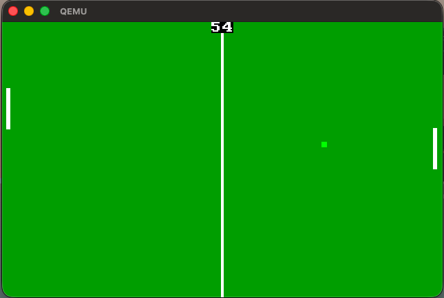
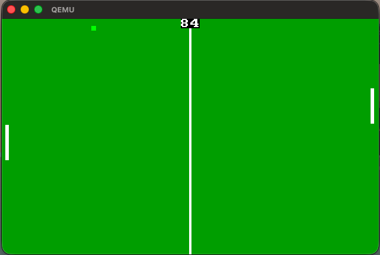

# Pong

A boot sector implementation of the game Pong written in x86 asm featuring score tracking, a computer controller player and automatic game resets once one player reaches 9 points. The game takes up 485 bytes and is padded up to 512 bytes to fill in a whole sector.

## Run project

### Method 1
Use Qemu as an emulator and boot the boot.img file using the command 
```
qemu-system-i386 -drive file=boot.img,format=raw
```
### Method 2
Burn the boot.img file to a usb stick/drive and boot on physical hardware using legacy/csm boot mode. The boot.img must be burnt to the first 512 bytes of the drive otherwise the game will not be bootable.

*Note Compatibility may vary, the game worked fine on an older system with an i5-4460 but I encountered glitches not present on the emulator or older system on my more modern pc with an i5-13600kf and a dedicated gpu*

## Screenshots
<div>
  
  
</div>

